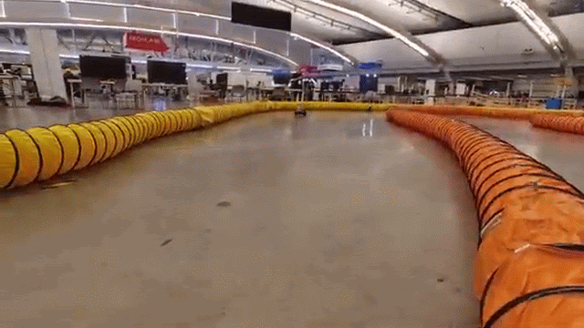
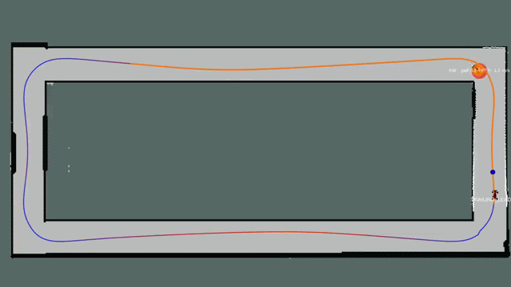

<!-- 
**Autonomous Racing Software Stack | IROS 2026 RoboRacer Autonomous Grand Prix**  
*Sep. 2026 – Present*

**Category:** robotics

- Developed a C++/ROS 2 autonomy stack for a 1/10-scale race car powered by NVIDIA Jetson Orin, integrating LiDAR perception, localization, motion planning, and vehicle control.
- Implemented map-aware LiDAR obstacle detection and tracking using spatial clustering, nearest-neighbor association, and Kalman filtering to identify static obstacles and moving opponents.
- Built a Frenet-frame local planner sampling ~190 candidate trajectories, evaluating track boundaries, braking constraints, and predicted collisions to enable autonomous overtaking, obstacle avoidance, and race-rule compliance.
- Developed adaptive-lookahead Pure Pursuit control with curvature-aware speed limits and braking-constrained velocity profiles; tuned control parameters for racing stability and performance.
- Integrated SLAM Toolbox mapping and CUDA-based particle-filter localization; passed organizer-required obstacle-avoidance tests and finished **7th at the IROS 2026 RoboRacer Grand Prix**.

Built and deployed a full autonomous racing stack on a 1/10-scale car powered by NVIDIA Jetson Orin and ROS 2. The system integrates CUDA-accelerated particle-filter localization, LiDAR-based obstacle tracking, Frenet-frame trajectory planning, and adaptive Pure Pursuit control for real-time autonomous racing. It supports dynamic obstacle avoidance, overtaking, and race-aware decision-making, achieving 7th place at the IROS 2026 RoboRacer Grand Prix.

Developed a ROS 2 autonomous racing system integrating GPU-accelerated localization, LiDAR perception, Frenet-frame motion planning, and adaptive Pure Pursuit control. Deployed on a 1/10-scale race car, placing 7th at the IROS 2026 RoboRacer Grand Prix. -->

# Autonomous Racing Software Stack | IROS 2026 RoboRacer 

#### *Placing 7th at the IROS 2026 RoboRacer Grand Prix.*

*Sep. 2026*

---

## Overview

Built and deployed a full autonomous racing stack on a 1/10-scale car powered by NVIDIA Jetson Orin and ROS 2. The system integrates CUDA-accelerated particle-filter localization, LiDAR-based obstacle tracking, Frenet-frame trajectory planning, and adaptive Pure Pursuit control for real-time autonomous racing. It supports dynamic obstacle avoidance, overtaking, and race-aware decision-making, achieving 7th place at the IROS 2026 RoboRacer Grand Prix.

<!--  -->



---

## Technical Highlights

- Developed a C++/ROS 2 autonomy stack for a 1/10-scale race car powered by NVIDIA Jetson Orin, integrating LiDAR perception, localization, motion planning, and vehicle control.
- Implemented map-aware LiDAR obstacle detection and tracking using spatial clustering, nearest-neighbor association, and Kalman filtering to identify static obstacles and moving opponents.
- Built a Frenet-frame local planner sampling ~190 candidate trajectories, evaluating track boundaries, braking constraints, and predicted collisions to enable autonomous overtaking, obstacle avoidance, and race-rule compliance.
- Developed adaptive-lookahead Pure Pursuit control with curvature-aware speed limits and braking-constrained velocity profiles; tuned control parameters for racing stability and performance.
- Integrated SLAM Toolbox mapping and CUDA-based particle-filter localization; passed organizer-required obstacle-avoidance tests and finished **7th at the IROS 2026 RoboRacer Grand Prix**.

